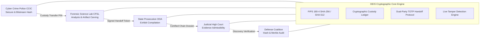

# Digital Evidence Integrity System (DEIS)

<div align="center">


[](LICENSE)
[](https://www.iso.org/standard/44381.html)
[](https://csrc.nist.gov/publications/detail/fips/180-4/final)
[-purple.svg?style=flat-square)](https://www.law.cornell.edu/rules/fre/rule_902)
[](#-how-to-run-locally)

**A client-side, air-gapped cryptographic chain-of-custody and digital evidence management platform for Law Enforcement, Forensic Science Laboratories, State Prosecutors, Courts, and Defense Counsel.**

[Key Features](#-core-capabilities) • [Quick Start](#-how-to-run-locally) • [GitHub Upload Guide](#-how-to-upload-to-github) • [Architecture](#-system-architecture) • [Directory Structure](#-repository-structure) • [Credentials](#-administrator-credentials)

</div>

---

## 📌 Overview

In criminal investigations and judicial proceedings, digital evidence (disk images, CCTV recordings, volatile memory dumps, and mobile extractions) frequently faces admissibility challenges due to broken chain-of-custody documentation, undetected bit corruption, or allegations of tampering.

The **Digital Evidence Integrity System (DEIS)** solves this by enforcing an **immutable cryptographic audit trail** at every stage of the evidence lifecycle. Operating entirely client-side via native browser `WebCrypto` primitives, DEIS runs without external servers or internet dependencies, making it safe for **air-gapped forensic networks** and **secure courtrooms**.

---

## 🏛️ System Architecture



---

## 🚀 Core Capabilities

### 1. 📂 Case Files Dossier & Structured Evidence Vault
- Digital evidence artifacts are organized directly under dedicated **Investigation Case Files** (e.g. `CR-2026-8831: State v. Apex Infrastructure Breach`).
- Physical evidence files and forensic metadata are stored on local disk inside organized folders under [`evidence_vault/`](evidence_vault/).
- Quick `+ Store Evidence in this Case` workflow automatically tags, classifies, and seals new artifacts inside their assigned investigation dossier.

### 2. 🔐 Dual-Party Custody Transfer Protocol
- Custody handoffs require simultaneous dual-agency authorization (Sending Officer and Receiving Officer).
- Generates ephemeral **6-digit TOTP verification PINs**, **transfer manifest hashes**, and **cryptographic 2D QR handover barcodes**.
- The receiving agency cannot accept custody until the transfer manifest and package token are verified.

### 3. ⛓️ Blockchain Custody Ledger & Tamper Engine
- Block-by-block immutable audit ledger linking `BlockHeight`, `PreviousBlockHash`, `BlockHash`, Merkle tree roots, and officer digital signatures.
- **Interactive Tamper Simulator:** Allows forensic trainees and auditors to simulate adversarial bit manipulation on any historical block to observe immediate cryptographic chain breakage and alert triggers.

### 4. 🔬 Advanced File Authenticity Scanner & Verifier
- **Auto-Scan & Cross-Reference:** Drag and drop any external file to compute its genuine SHA-256/SHA-512 fingerprint and automatically cross-reference it against all vault records to identify matches.
- **Side-by-Side Target Comparator:** Select a sealed vault record and compare it against a local file with 0-bit deviation confirmation (`✓ IDENTICAL` or `✗ MISMATCH DETECTED`).
- **Live Avalanche Effect Sandbox:** Real-time demonstration showing how modifying even a single character in a record completely alters the resulting 256-bit hash.
- **Printable Verification Affidavit:** One-click legal affidavit certifying zero-bit deviation pursuant to **FRE Rule 902(14)**.

### 5. 📜 Certified Legal Evidence Certificate
- Produces court-ready, self-authenticating digital evidence certificates compliant with **ISO/IEC 27037:2012** and **FRE Rule 902(14)**.
- Includes complete chronological custody history, cryptographic fingerprints, lead forensic examiner signatures, and judicial clerk seals.

### 6. 👥 Identity Governance & Personnel Management
- Zero pre-populated mock users.
- Only the **Root Security Administrator** (`ADMIN-0001`) can provision officers and assign their operating agency clearances (Police, Lab, Prosecution, Court, or Defense).

---

## 🔑 Administrator Credentials

Initial access to the system is restricted to the pre-configured Security Administrator:

| Credential Field | Value |
| :--- | :--- |
| **Officer / Badge ID** | `ADMIN-0001` |
| **Password** | `admin@0001` |
| **Clearance Level** | `LEVEL 6 — ROOT SECURITY & ACCESS CONTROL` |
| **Department** | `Root Access & Identity Control Authority` |

> 💡 **Tip:** After logging in, navigate to **"Manage Officers"** (`#users`) to register and issue credentials for detectives, forensic analysts, prosecutors, and magistrates.

---

## 📁 Repository Structure

```
digital-evidence-integrity-system/
│
├── index.html                     # Main application entry point (single-page application)
├── start.bat                      # 1-click Windows launcher (opens DEIS in default browser)
├── open_storage_folders.bat       # 1-click shortcut to view database and evidence folders
├── setup_git.bat                  # Automated assistant to initialize and push to GitHub
│
├── .gitignore                     # Git ignore rules for OS, temp, and cache files
├── .gitattributes                 # Cross-platform line endings and binary file declarations
├── LICENSE                        # Official MIT License
├── README.md                      # Comprehensive project documentation
├── CONTRIBUTING.md                # Open-source contribution guidelines
├── SECURITY.md                    # Security policy and cryptographic assurance disclosures
│
├── css/
│   └── styles.css                 # Standalone stylesheet (dark cyber forensic theme, CSS resets)
│
├── js/
│   ├── app.js                     # Central controller, route manager, and modal dispatcher
│   ├── crypto.js                  # Native WebCrypto engine (SHA-256, SHA-512, signatures, Merkle roots)
│   ├── db.js                      # IndexedDB relational client and schema synchronizer
│   ├── icons.js                   # Self-contained zero-dependency vector icon engine (40+ SVG icons)
│   ├── offline-helpers.js         # Offline QR matrix barcode generator and visual effects
│   ├── store.js                   # Central state store (agencies, cases, evidence, transfers, blocks)
│   │
│   └── views/
│       ├── loginView.js           # Secure authentication gateway with quick-fill administrator login
│       ├── dashboardView.js       # Executive command console, status counters, and active transfers
│       ├── evidenceView.js        # Case Files dossiers and stored evidence artifacts manager
│       ├── transferView.js        # Dual-party custody dispatch, PIN verification, and receipts
│       ├── chainView.js           # Blockchain custody ledger and interactive tamper simulator
│       ├── verifierView.js        # 3-mode file authenticity scanner, comparator, and tamper sandbox
│       ├── certificateView.js     # ISO/IEC 27037 self-authenticating court certificate generator
│       └── userManagementView.js  # Administrator user provisioning and role assignment portal
│
├── database/                      # Physical database records stored on local computer disk
│   ├── schema.sql                 # ANSI SQL schema (SQLite, PostgreSQL, MySQL compatible)
│   ├── cases.json                 # JSON database of registered criminal investigation cases
│   ├── evidences.json             # JSON database of evidence artifacts and cryptographic digests
│   ├── users.json                 # JSON database of registered personnel and credentials
│   ├── transfers.json             # JSON database of custody transfer transactions and PIN tokens
│   ├── blockchain_ledger.json     # JSON database of genesis blockchain ledger blocks
│   └── README.md                  # Relational schema documentation and ER diagrams
│
└── evidence_vault/                # Physical evidence storage repository on local computer disk
    ├── README.md                  # Physical storage vault documentation
    │
    ├── Case_CR-2026-8831_Apex_Breach/
    │   ├── CASE_FILE_SUMMARY.txt  # Case dossier overview, crime category, and judicial metadata
    │   ├── EVD-2026-0941_memory_dump.raw       # Volatile RAM dump artifact (16.4 GB sample)
    │   └── EVD-2026-1182_surveillance_feed.mp4 # 4K CCTV data extract artifact (4.8 GB sample)
    │
    └── Case_CR-2026-9042_DarkLocker_Ransomware/
        ├── CASE_FILE_SUMMARY.txt  # Case dossier overview, crime category, and judicial metadata
        └── EVD-2026-2401_darklocker_clone.e01  # Bitstream forensic clone artifact (512 GB sample)
```

---

## 💻 How to Run Locally

DEIS requires **zero compilation, zero installation of Node.js or npm, and zero database server configuration**.

1. **Clone or Download** this repository to your computer:
   ```bash
   git clone https://github.com/<your-username>/digital-evidence-integrity-system.git
   ```
2. **Launch the application:**
   - On **Windows**: Double-click [`start.bat`](start.bat).
   - On **macOS / Linux**: Open [`index.html`](index.html) in Chrome, Brave, Edge, or Firefox.
3. Log in with `ADMIN-0001` and password `admin@0001`.

---

## 📤 How to Upload to GitHub

You can publish this project to your GitHub account using any of the 3 simple methods below:

### Method 1: Using the Automated Assistant (`setup_git.bat`)
1. Double-click [`setup_git.bat`](setup_git.bat) in the project folder.
2. The script will automatically initialize Git, stage all files, and create your initial commit.
3. When prompted, paste your GitHub repository URL (created at [https://github.com/new](https://github.com/new)).
4. Press Enter — your repository is live on GitHub!

### Method 2: Using the Git Command Line (CLI)
Open a terminal (PowerShell, Command Prompt, or Git Bash) inside this project folder:

```bash
# 1. Initialize local git repository
git init

# 2. Stage all files (uses .gitignore automatically)
git add .

# 3. Create initial commit
git commit -m "feat: initial release of Digital Evidence Integrity System (DEIS) v1.0"

# 4. Set default branch to main
git branch -M main

# 5. Link your GitHub repository (replace with your actual repository URL)
git remote add origin https://github.com/<your-username>/digital-evidence-integrity-system.git

# 6. Push to GitHub
git push -u origin main
```

### Method 3: Using GitHub Website (No Git Installation Required)
1. Go to [https://github.com/new](https://github.com/new).
2. Name your repository (e.g., `digital-evidence-integrity-system`).
3. Leave **"Add a README file" UNCHECKED** (since this repo already has an extensive README).
4. Click **Create repository**.
5. On the page that appears, click the link that says **"uploading an existing file"**.
6. Select and drag all files from this folder directly into the GitHub web browser window.
7. Click **Commit changes**.

---

## 🌐 How to Deploy (Live Website Hosting)

Because DEIS is a pure static web platform that runs directly in browser memory via native WebCrypto, it can be deployed for **100% free with automated HTTPS/SSL** in seconds:

### Option A: Free Deployment via GitHub Pages (Built into GitHub)
1. In your GitHub repository, click **Settings** (top navigation tab).
2. On the left sidebar menu, click **Pages**.
3. Under **Build and deployment**:
   - **Source:** Select `Deploy from a branch`.
   - **Branch:** Select `main` and `/ (root)`.
4. Click **Save**.
5. Within 1 minute, GitHub will give you your live URL:
   `https://<your-username>.github.io/<repository-name>/`

### Option B: Instant Drag & Drop via Netlify (Live in 10 Seconds)
1. Open **[https://app.netlify.com/drop](https://app.netlify.com/drop)** in your browser.
2. Drag and drop this entire project folder into the box.
3. Done! Netlify immediately provides a free public, live `https://...netlify.app` web link.

### Option C: 1-Click Deployment via Vercel
1. Go to **[https://vercel.com/new](https://vercel.com/new)**.
2. Connect your GitHub account and import this repository.
3. Click **Deploy**. Vercel serves the app with automatic CDN caching and SSL.

---

## ⚖️ Legal & Forensic Standards Compliance

| Standard | Domain | Compliance Mechanism in DEIS |
| :--- | :--- | :--- |
| **ISO/IEC 27037:2012** | Digital Evidence Handling | Enforces standardized identification, collection, acquisition, and preservation protocols across all transfer workflows. |
| **FIPS 180-4** | Secure Hash Standard | Computes genuine 256-bit and 512-bit message digests in-browser using native `SubtleCrypto`. |
| **FRE Rule 902(14)** | Federal Rules of Evidence | Certified records generated by a process of digital identification; produces self-authenticating certificates. |
| **NIST SP 800-86** | Forensic Incident Response | Preserves bitstream integrity, source hardware serials, and write-blocker verification metadata. |
| **CJIS Policy 5.9** | Criminal Justice Security | Strict role-based identity control; restricts user provisioning strictly to the Root Administrator. |

---

## 📄 License

This project is licensed under the **MIT License** — see the [LICENSE](LICENSE) file for details.
