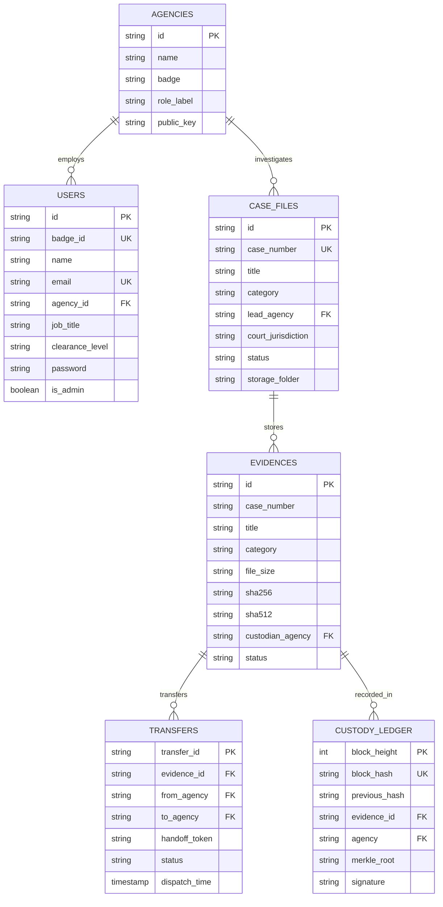

# Digital Evidence Integrity System (DEIS) — Database Documentation

This directory contains the database design, schema specification, and relational models for the **Digital Evidence Integrity System (DEIS)**.

---

## 1. Database Architecture Overview

DEIS employs a dual-tier storage strategy designed for zero-friction setup and production compatibility:

1. **Active Application Database (`IndexedDB`)**:
   - Database Name: `DEIS_EVIDENCE_VAULT_DB` (Version 1)
   - Runs client-side directly in the browser (Chrome, Brave, Edge, Firefox).
   - Real transactional object stores with indexes on `badgeId`, `sha256`, `caseNumber`, `status`.
   - Requires zero installation of servers (MySQL/Postgres) — operates automatically when opening `start.bat`.

2. **Relational SQL Export (`schema.sql`)**:
   - Standard ANSI-compliant SQL DDL and DML script.
   - Compatible with **SQLite 3**, **PostgreSQL 14+**, **MySQL 8.0**, and **MariaDB**.
   - Contains all foreign keys, unique constraints, and indexes for formal project submission and backend migration.

---

## 2. Relational Schema & Tables



---

## 3. How to Use & Export the Database

* **Viewing the Database in DEIS**:
  * Log in as `ADMIN-0001` (`admin@0001`).
  * Click **Database Explorer** in the left sidebar menu.
  * You will see the live tables (`users`, `evidences`, `transfers`, `custody_ledger`), record counts, and raw data rows.
* **Exporting to SQL**:
  * In the **Database Explorer**, click **Download SQL Dump (.sql)**.
  * A full `.sql` file containing all current users and evidences will be downloaded to your computer.
* **Loading into SQLite**:
  ```bash
  sqlite3 deis.db < schema.sql
  ```
* **Loading into PostgreSQL / MySQL**:
  ```bash
  psql -U postgres -d deis_db -f schema.sql
  # or MySQL:
  mysql -u root -p deis_db < schema.sql
  ```
